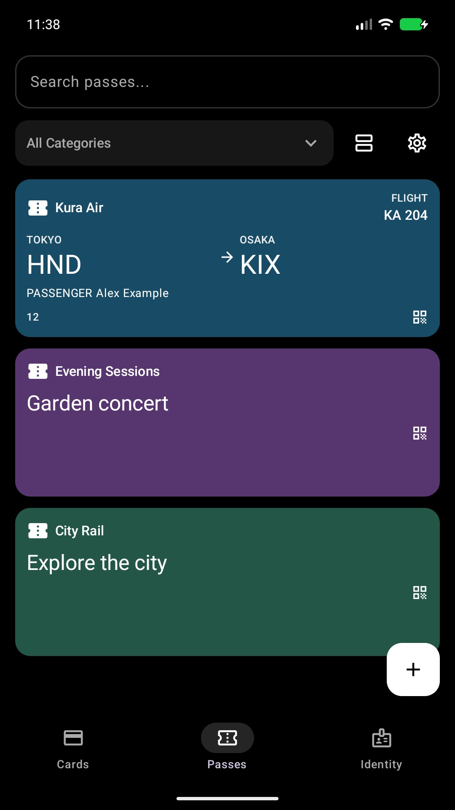
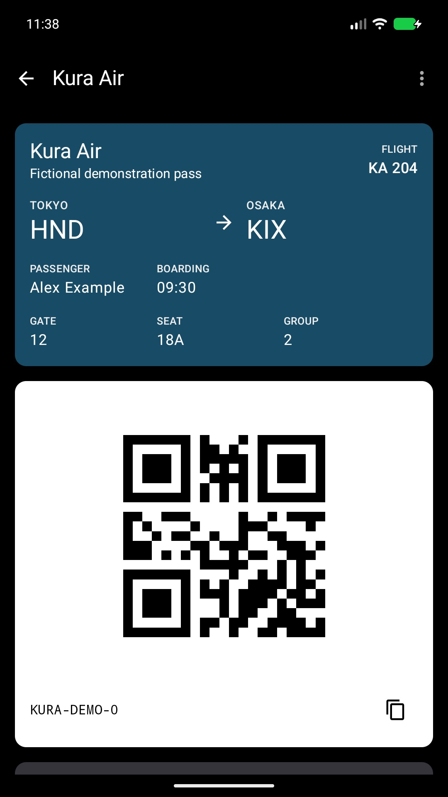

# Kura

Kura (蔵) keeps cards, passes and identity documents in an encrypted wallet on your phone. The stable Android app is available on GitHub. The iPhone app is available in beta.

[iPhone TestFlight beta](https://testflight.apple.com/join/5gXUyd4c)

**Support:** [Buy me a coffee](https://buymeacoffee.com/phillip9933) · [GitHub Sponsors](https://github.com/sponsors/phillip9933)

## Features

The Android release includes these features. See the [iPhone guide](ios/README.md) for beta features.

- **Cards, Passes and Identity** — three separate, swipeable sections.
- Import `.pkpass` files and `.pkpasses` bundles, scan barcodes or add items manually.
- Add logos, card images, attachments and custom fields.
- Find what you need with categories, favorites, search, sorting and archive.
- Show barcodes full screen when it is time to scan.
- Unlock with biometrics or your device credential, or choose phone-unlock-only access in Settings. Wallet data remains encrypted and sessions close on lock.
- Keep password-encrypted backups, optionally saved automatically to a folder you choose.

## Android screenshots

| Wallet | Boarding pass | Barcode |
| --- | --- | --- |
|  |  |  |

## Install and use

### Android

Download the Android APK from [Kura 2.2.0](https://github.com/phillip9933/Kura/releases/tag/v2.2.0). It requires Android 8.0 (API 26) or later and an arm64-v8a or x86_64 device. The older 2.1 APK and the default offline source build retain Android 7.0 (API 24) support. Android builds require a secure device lock and supported hardware-backed key storage.

The GitHub APK uses `app.kura.wallet`. The [draft Google Play build](https://github.com/phillip9933/Kura/pull/36) uses a separate application ID, `app.kura.wallet.play`. To move a wallet between these packages, export an encrypted full backup from the original app. Restore it in the other app and check your records and images before you remove the original. See [backup and migration](docs/BACKUP_AND_MIGRATION.md).

#### Optional Android card scanning

The enhanced-scanning build (`-PcardScanner=true`) detects card edges and offers optional offline English and Japanese OCR. Review the suggestions before you save them. See [card scanning](docs/CARD-RECOGNITION.md) for build options, controls and limitations.

### iPhone

On an iPhone with iOS 16 or later, open the TestFlight invitation above and follow Apple’s installation steps. The iPhone app uses its own backup format. Android and iPhone backups cannot be exchanged. See the [iPhone guide](ios/README.md) for features and device requirements.

## Privacy and security

Kura has no accounts, advertising or telemetry. The default Android source build has no Internet permission. The GitHub APK can check GitHub for updates; see [app updates](docs/APP-UPDATES.md).

Kura stores card references and barcodes. It does not make NFC payments or verify imported pass issuer signatures. Sharing files or opening links sends data to another app. Read the [privacy policy](PRIVACY.MD) and the [security policy](SECURITY.md) for details and reporting instructions.

## Development and contributing

Android uses Kotlin, Jetpack Compose and Material 3. With JDK 21 and Android SDK 37.0, run `./gradlew :app:assembleDebug` from the repository root to build the offline Android app. The iPhone app uses SwiftUI. Open `ios/Kura.xcodeproj` in Xcode and select the Kura scheme. See [Contributing](CONTRIBUTING.md) for setup and checks. The [documentation index](docs/README.md) covers architecture, development and release tooling. Test and profiling helpers live in `tools/`.

[Changelog](CHANGELOG.md) · [Release roadmap](https://github.com/users/phillip9933/projects/2/views/2) · [Work board](https://github.com/users/phillip9933/projects/2/views/1) · [Issue conventions](CONTRIBUTING.md#public-roadmap-and-issue-management)

Follow release scope and maturity separately from individual work. Dates are estimates. Unscheduled ideas have no release milestone. Check the documented limitations before you use Kura. There is no fixed support schedule.

See [testing evidence](docs/TESTING.md), [security review](docs/SECURITY_REVIEW.md) and [contribution guidance](CONTRIBUTING.md#ai-usage).

## License

Licensed under [AGPL-3.0](LICENSE). Kura originated as a fork of [Wallet by Sidhant](https://github.com/sidhant947/Wallet).

## AI usage

I use AI tools for analysis, implementation, tests, and documentation. I decide what ships and take responsibility for maintaining it. Project-specific testing and known limitations are documented separately.
