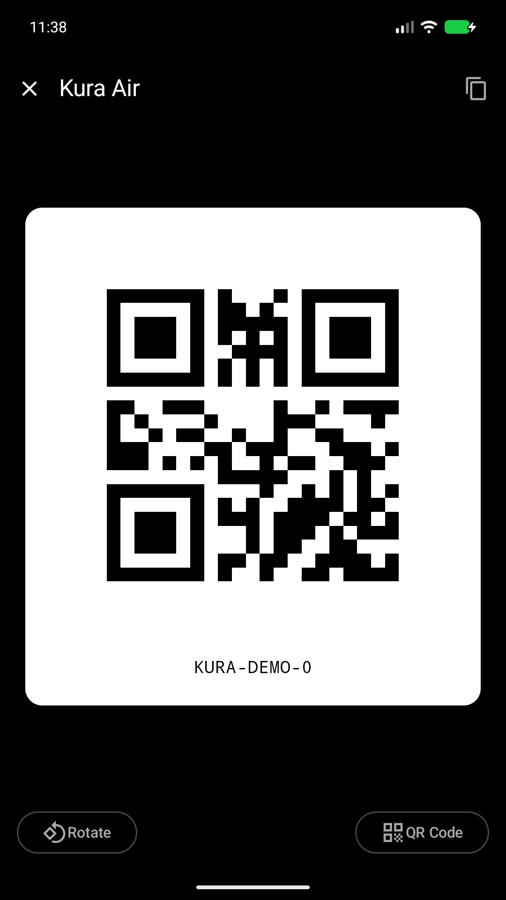

# Kura

Kura (蔵) stores cards, passes and identity documents in an encrypted, offline Android wallet.

**Support:** [Buy me a coffee](https://buymeacoffee.com/phillip9933) · [GitHub Sponsors](https://github.com/sponsors/phillip9933)

## Features

- **Cards, Passes and Identity** — three separate, swipeable sections.
- Import `.pkpass` files and `.pkpasses` bundles, scan barcodes or add items manually.
- Add logos, card images, attachments and custom fields.
- Find what you need with categories, favorites, search, sorting and archive.
- Show barcodes full screen when it is time to scan.
- Unlock with biometrics or your device credential, or choose phone-unlock-only access in Settings. Wallet data remains encrypted and sessions close on lock.
- Keep password-encrypted backups, optionally saved automatically to a folder you choose.

## iPhone development

The native iPhone app supports cards, passes and IDs, scanning, local media and encrypted backups. The [iPhone guide](ios/README.md) covers features, the Xcode project and device acceptance.

## Android screenshots

| Wallet | Boarding pass | Barcode |
| --- | --- | --- |
|  |  |  |

## Install and use

Download the Android APK from [Kura 2.2.0](https://github.com/phillip9933/Kura/releases/tag/v2.2.0). It requires Android 8.0 (API 26) or later and an arm64-v8a or x86_64 device. The older 2.1 APK and the default offline source build retain Android 7.0 (API 24) support. All builds require a secure device lock and supported hardware-backed key storage.

### Optional card scanning

The enhanced-scanning build (`-PcardScanner=true`) detects card edges and offers optional offline English and Japanese OCR. Review the suggestions before you save them. See [card scanning](docs/CARD-RECOGNITION.md) for build options, controls and limitations.

## Privacy and security

Kura has no accounts, advertising or telemetry. The default source build has no Internet permission. The GitHub APK can check GitHub for updates; see [app updates](docs/APP-UPDATES.md).

Kura stores card references and barcodes. It does not make NFC payments or verify imported pass issuer signatures. Sharing files or opening links sends data to another app. Read the [privacy policy](PRIVACY.MD) and the [security policy](SECURITY.md) for details and reporting instructions.

## Development and contributing

Kura 2.0 uses Kotlin, Jetpack Compose and Material 3. Start with [Contributing](CONTRIBUTING.md) for setup and checks. The [documentation index](docs/README.md) covers architecture, development and release tooling. Test and profiling helpers live in `tools/`.

[Changelog](CHANGELOG.md) · [Release roadmap](https://github.com/users/phillip9933/projects/2/views/2) · [Work board](https://github.com/users/phillip9933/projects/2/views/1) · [Issue conventions](CONTRIBUTING.md#public-roadmap-and-issue-management)

Follow release scope and maturity separately from individual work. Dates are estimates. Unscheduled ideas have no release milestone. Check the documented limitations before you use Kura. There is no fixed support schedule.

See [testing evidence](docs/TESTING.md), [security review](docs/SECURITY_REVIEW.md) and [contribution guidance](CONTRIBUTING.md#ai-usage).

## License

Licensed under [AGPL-3.0](LICENSE). Kura originated as a fork of [Wallet by Sidhant](https://github.com/sidhant947/Wallet).

## AI usage

I use AI tools for analysis, implementation, tests, and documentation. I decide what ships and take responsibility for maintaining it. Project-specific testing and known limitations are documented separately.
