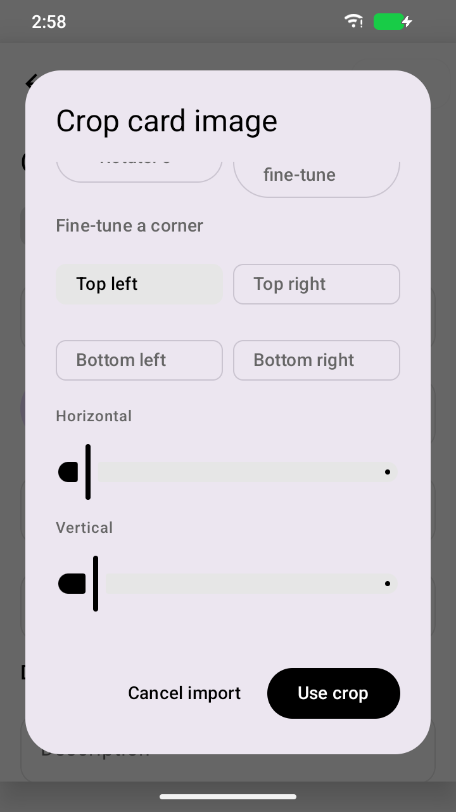
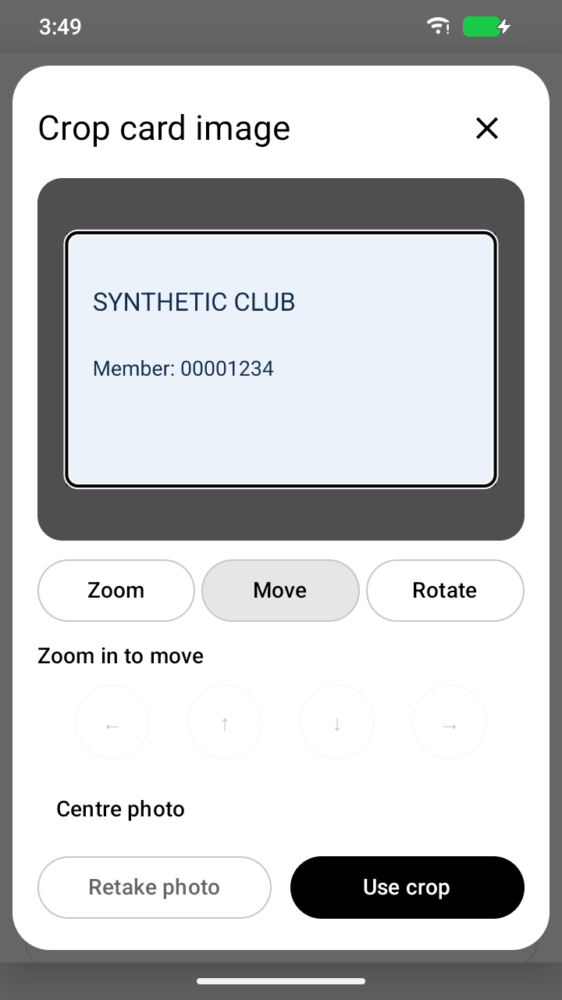

# Design: card images

This scoped design covers the owner-requested card-crop revision. It is a draft
for owner review, not a complete design specification for the wallet. Other
screens, full assistive-technology coverage and broader usability review remain
documentation/verification gaps.

## Purpose and journey

The owner wants to frame front/back card photos without moving document corners
or losing sight of the photo while adjusting it. After camera/picker capture,
Kura proposes a card alignment locally. A stationary mask shows the final frame;
the user moves, zooms and rotates the photo underneath it, then chooses **Use
crop**. Optional OCR still asks separately and only suggests existing empty
fields. The form's explicit Save owns persistence. Cancel/retake preserve the
existing form and front/back destination.

Automatic perspective correction remains a starting proposal. **Full photo**
restores the original capture and its proportions when detection chose the wrong
region. New imports and **Auto fit** start with a horizontal credit-card frame,
using the [ID-1 dimensions of 85.60 × 53.98 mm](https://www.epo.org/boards-of-appeal/decisions/pdf/t140876eu1.pdf)
(width/height ≈ 1.586). The mask stays horizontal while the photo rotates beneath
it. Photo proportions, portrait card and square remain explicit alternatives.
Differing documents are supported; a standard card ratio
is a convenience, not a validity rule. Users inspect the visible frame before
cropping. No OCR confidence or detected edge is treated as verified content.

## Layout and controls

Use Material 3 colors, typography and standard buttons/slider semantics, following
[Android adaptive layouts](https://developer.android.com/develop/ui/compose/layouts/adaptive)
and [accessible Compose components](https://developer.android.com/develop/ui/compose/accessibility).
The crop dialog uses the available safe window area. Portrait places a fixed
preview above a separately scrollable adjustment pane; landscape places them
side by side. Scrolling controls never scrolls the photo. Cancel and crop actions
remain outside that pane. Large text may require scrolling controls, with the
preview still visible. The subsequent OCR offer/review uses a wider Material
dialog in landscape so large text does not stack actions and collapse its
scrolling region.

Zoom, Move and Rotate stay pinned above the adjustment scroller. Selecting a
mode scrolls its controls into view; shape and recovery controls follow them.
Rotation presets use two columns at large text sizes. These choices keep common
actions reachable without hiding the preview. Pinch and
drag are shortcuts; zoom/angle sliders, labelled increment buttons, rotation
presets and directional movement buttons provide alternatives to precise
gestures. Targets use native 48 dp minimum touch sizing. The selected tab, current
value and button state use text/semantics as well as color. Disabled/busy states
block competing transformations; loading/error messages preserve cancellation
and usable recovery. Keep text readable in light/dark themes and at 200% scale.

## Image correctness and privacy

Preview and crop output share one normalized affine mapping. Clamp every angle,
zoom and translation so the frame lies inside the source, avoiding empty output
edges. Quarter-turns with photo proportions preserve the full image; custom-angle
and standard-ratio framing visibly select a smaller region. Always sample the
chosen original/auto-aligned image, never repeatedly resample previous edits.
Round mask corners are visual framing; the saved JPEG retains its rectangular
bounding area. Encrypted media, backup/database formats, session cancellation and
owned-buffer wiping stay under the existing [architecture](ARCHITECTURE.md).

## Review and evidence

Reproduce the old photo/control visibility failure on a small mobile viewport.
Check portrait/landscape, light/dark and 200% text with synthetic cards. Verify
landmark pixels against the preview mapping, rotation/pan/zoom boundaries,
alternate proportions, full-photo/reset, cancel/retake/re-entry, front/back and
optional OCR/save journeys. Record actual screenshots/results and failures in
Testing; compile success is not visual validation or owner sign-off. The owner
must review this crop revision before publication. Physical-device and stable
release acceptance remain separate. The owner accepted the horizontal crop's
appearance in the local card-mask-fix testing build on 7 November 2026; that
feedback does not constitute physical/data-safety or stable-release acceptance.

## Card-detail image slots

Manual cards keep both labelled front/back slots visible on their details
screen. Each missing side independently offers the existing edit icon with
Choose photo and Take photo, even when the other side already has an image.
Cancelling capture/selection leaves the record unchanged. An existing image
opens its viewer; replacement/removal continues through Edit card. Imported
pass images retain their read-only details presentation and do not gain empty
front/back placeholders. These controls reuse the existing Material image menu
and image-import ownership/confirmation path.

## Visual review gallery

These are unedited captures of synthetic cards from a disposable emulator.
The older editor loses the photo when its corner controls are reached. The
replacement keeps the preview and actions fixed; rotation edits that same
preview. The 200% landscape capture checks readable pinned modes.

| Prior editor | Stationary mask |
| --- | --- |
|  |  |

[Rotation and retained framing](images/card-crop/rotation.png) ·
[Landscape at 200% text, dark theme](images/card-crop/large-text-landscape.png).
Exact source scopes and image hashes are in the [test evidence](evidence/card-mask-20261107.json).
